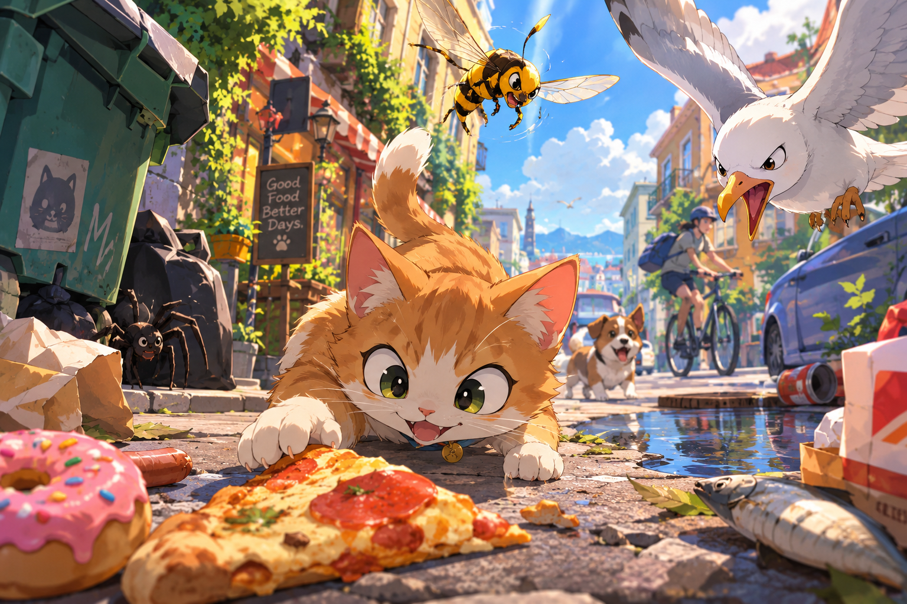

# Snack Run

3D-игра про котёнка, который собирает вкусняшки в городе и уворачивается от собак, ос, велосипедистов, чаек и крабов.
Сделана для ролика YouTube-канала «Нейрослоп» как эксперимент по вайб-кодингу 3D: весь код, 3D-модели (Python-скрипты
для Blender), уровни, тесты и документацию написали модели Claude (Fable 5.1 — планы 1–5, Opus 5.5 — планы 6–21)
в Claude Code. Человек ставил задачи, играл и давал замечания.



## Что внутри

- **Три района:** двор с кафе, парк с прудом и холмом, порт с морем, лодками и рыбалкой. Ворота открываются по сытости.
- **Смена дня и ночи**, музыка, позиционные звуки.
- **Опасности:** собака, оса, велосипедист, дождеватели, голуби, садовник, ребёнок, сторож, чайки, волны, погрузчик, крабы.
- **Прогрессия:** альбом из 20 вкусняшек, клубочки, магазин улучшений и скинов, сохранения.
- **Обучение** и переназначение клавиш.

## Запуск

Нужны [Godot 4.7.2](https://godotengine.org) и (для пересборки моделей) [Blender 5.2.2](https://www.blender.org); пути к ним — в `Makefile`.

```
make run           # играть: WASD, мышь/Q/R/T/G — камера, Shift — бег, Space — прыжок, Ctrl — спрятаться, E — есть/магазин, Tab — альбом, Esc — пауза
make test          # Python-, Blender- и GUT-тесты
make assets        # пересобрать 3D-модели из tools/blender/gen/*.py
make layout        # пересобрать уровни из data/layout_src/*.json
make export        # macOS-сборка build/SnackRun.zip
```

Готовые модели (`assets/models/*.glb`), картинки и звуки лежат в репозитории, Blender и ключ OpenAI для запуска не нужны.

## Как это делалось

- `docs/superpowers/specs/` — спеки (визуальная библия, игровой цикл, этапы), `docs/superpowers/plans/` — 21 план разработки и дорожная карта.
- `docs/replay/` — пошаговая инструкция, по которой другой агент может повторить проект с трёх концепт-артов из `reference/`.
- `CLAUDE.md` — памятка для модели: правила владельца, команды, структура, все «грабли».
- История коммитов — по плану: ветка, тесты сначала, ревью свежим субагентом, слияние.

## Лицензии

- Код, сгенерированные скриптами модели, уровни и документация — **MIT** (`LICENSE`).
- Картинки (иконки, текстуры, концепт-арты) сгенерированы OpenAI `gpt-image` по манифесту `tools/images/manifest.json`.
- Сторонние ассеты — **CC0**, авторы указаны в README каждой папки:
  - кот и собака — Quaternius, Animal Pack Vol.2 (`third_party/quaternius_animal_pack_v2/`);
  - люди — Quaternius, Animated Human (`third_party/quaternius_animated_human/`);
  - голубь — mujtaba-io (`third_party/pigeon_mujtaba/`);
  - краб — methodical pixel (`third_party/crab_methodicalpixel/`);
  - звуки — Kenney и др. (`assets/sfx/README.md`);
  - музыка — OwlishMedia, congusbongus, AntumDeluge / Brandon Morris (`assets/music/README.md`).
- **Оговорка про UniMate.** Клипы кота `jump`, `hide`, `hit`, `run` (`third_party/unimate_clips/`) сгенерированы моделью
  [UniMate](https://github.com/Friedrich-M/UniMate) на основе CC0-рига. Код UniMate распространяется под MIT, а для весов
  модели явной лицензии мы не нашли. Если вам важна чистота прав, замените эти четыре клипа.
- Аддон GUT (`addons/gut/`) — MIT, © его авторы.
